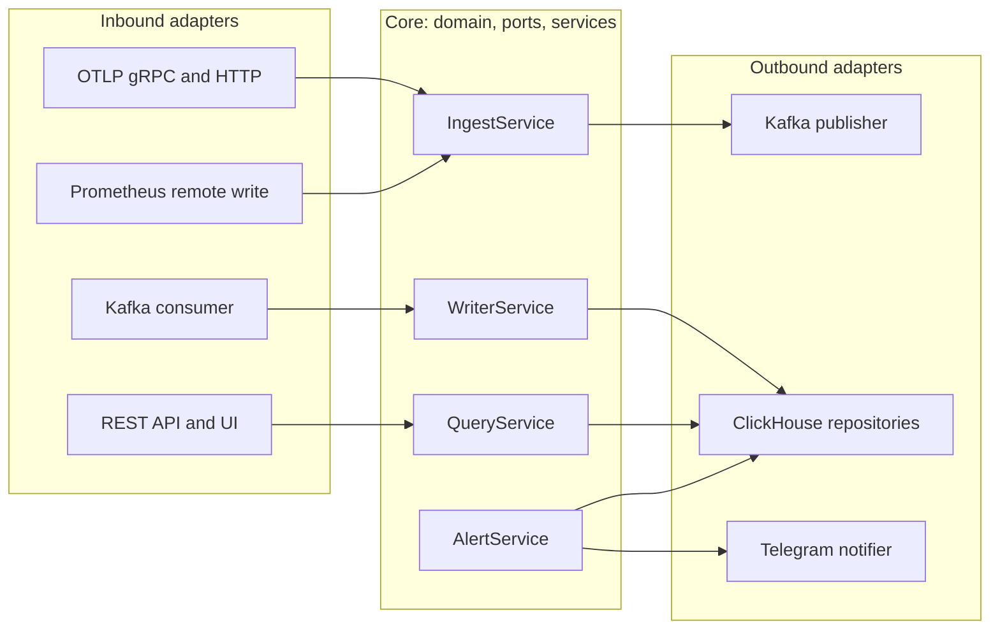

# Vindice

Self-hosted observability for logs, traces and metrics. Search every log, see the logs inside each trace, get alerts in Telegram, and run it all on one small server.

<picture>
  <source media="(prefers-color-scheme: dark)" srcset="docs/assets/screenshots/services-dark.png">
  
</picture>

## What you get

| Feature | What it does | For |
|---|---|---|
| **Services** | Request rate, error rate and p50/p95/p99 latency per service and per operation | everyone on call |
| **Logs** | Full-text search, filters for service and level, a histogram by level, one click to the trace | developers debugging |
| **Traces** | Waterfall view, with the logs written inside that trace on the same page | developers debugging |
| **Metrics and dashboards** | Chart any metric (`rate`, `avg`, `max`, ...), group it by an attribute, and pin charts to dashboards | team leads, SRE |
| **Alerts** | Thresholds on error rate, latency, metrics or log counts, sent to Telegram on firing and on resolve | whoever is on call |
| **Team access** | Sign-in with viewer, editor and admin roles, plus API keys for the services that send data | admins |

## A closer look

| | |
|---|---|
| <picture>   <source media="(prefers-color-scheme: dark)" srcset="docs/assets/screenshots/logs-dark.png">    </picture> | <picture>   <source media="(prefers-color-scheme: dark)" srcset="docs/assets/screenshots/trace-dark.png">    </picture> |
| **Logs.** Search every line, filter by level, see the volume per level over time. | **Traces.** The waterfall and the logs written inside that request, on one page. |
| <picture>   <source media="(prefers-color-scheme: dark)" srcset="docs/assets/screenshots/service-dark.png">    </picture> | <picture>   <source media="(prefers-color-scheme: dark)" srcset="docs/assets/screenshots/dashboard-dark.png">    </picture> |
| **Services.** Request rate, errors and latency for each service and operation. | **Dashboards.** Pin service measures, metrics and log counts to shared dashboards. |

## How it works

<picture>
  <source media="(prefers-color-scheme: dark)" srcset="docs/assets/architecture-dark.svg">
  
</picture>

Data flows left to right:
- **Ingest.** Applications send OTLP (or Prometheus remote write) with an API key. Ingest acknowledges a request only after Kafka has it.
- **Writer.** It drops noise, samples traces (every failing or slow trace is kept), counts request metrics before sampling, and writes large batches to ClickHouse.
- **Query and alert.** Both read from ClickHouse, using pre-aggregated per-minute tables wherever possible.

## Why Vindice

Compared with running the Grafana LGTM stack (Loki, Grafana, Tempo, Mimir) yourself:

| | Vindice | LGTM stack |
|---|---|---|
| **To run** | 3 containers: vindice (one Go binary with the UI built in), Kafka, ClickHouse | Loki, Tempo, Mimir or Prometheus, Grafana, plus an agent |
| **Searching log text** | Indexed full-text search over all logs | Loki indexes labels only; text filters scan the matching chunks |
| **High-cardinality fields** (user id, order id) | Fine to keep as attributes | Must stay out of labels, or the index grows |
| **Logs next to traces** | Built in on the trace page | Configured per data source |
| **Query languages to learn** | None; the UI builds the queries | LogQL, TraceQL, PromQL |
| **Trace sampling** | Built-in tail sampling keeps every failing or slow trace; request rates are counted before sampling, so they stay exact | Set up separately in the collector |
| **When storage is down** | Kafka holds incoming data and the writer catches up afterwards | Depends on each component's write-ahead log |

It is cheap to run as well:
- **Small footprint.** Measured at idle with demo data, the whole stack used about 1.5 GB of RAM: ClickHouse about 990 MB, Kafka about 430 MB and vindice about 60 MB.
- **Storage shrinks over time.** Debug logs expire after 3 days and errors after 90. Metrics are rolled up to 1-minute and 1-hour resolution. Trace IDs are stored in binary form, and repeated attributes are stored once.
- **Inputs you already have.** Any OpenTelemetry SDK or Collector works, so does Prometheus remote write, and there is a one-call Go SDK.

**Where LGTM is still ahead:**
- PromQL and its large catalogue of ready-made dashboards and exporters.
- Mature alert routing, such as silences and on-call schedules.
- Object-storage-first long retention.
- A much larger community.

You don't have to choose up front. Send the same data to both from an OpenTelemetry Collector or Grafana Alloy, and compare them on your own traffic.

## Quick start

You need Docker with Compose, and `make`.

```bash
git clone https://github.com/b1ll1eee/vindice-observability && cd vindice-observability
make up                                                # start Kafka, ClickHouse and vindice
docker logs vindice-vindice-1 2>&1 | grep "first admin"  # one-time admin password
open http://localhost:8080                             # sign in, then create a key under API keys
make demo KEY=vdc_...                                  # send sample traces, logs and metrics
```

## Send your data

OpenTelemetry SDKs and Collectors only need two environment variables:

```bash
OTEL_EXPORTER_OTLP_ENDPOINT=http://vindice-host:4318   # gRPC: vindice-host:4317
OTEL_EXPORTER_OTLP_HEADERS="Authorization=Bearer vdc_..."
```

Go services can use the SDK, which also links logs to traces. See [sdk/README.md](sdk/README.md).

```go
sdk, err := vindice.Start(ctx, vindice.Config{ServiceName: "orders"}) // reads VINDICE_ENDPOINT, VINDICE_API_KEY
defer sdk.Shutdown(context.Background())
http.ListenAndServe(":8080", vindice.Handler(mux, "orders"))
```

Prometheus can forward everything it scrapes:

```yaml
remote_write:
  - url: http://vindice-host:4318/api/v1/write
    authorization:
      credentials: vdc_...
```

## Inside the code



Vindice follows a hexagonal (ports and adapters) design:
- **The core holds the rules.** It owns sampling, retention, alert state and permissions, and talks to the outside only through interfaces.
- **Adapters do the plumbing.** They translate between those interfaces and OTLP, Kafka, ClickHouse, HTTP and Telegram, so each piece can be tested on its own or swapped.
- **Reads and writes are separate.** Charts read pre-aggregated rollups without touching the write path.
- **Everything is wired in one place,** `cmd/vindice/main.go`. The same binary runs as one process or split into `ingest`, `writer`, `query` and `alert` processes when traffic grows.

## Everyday commands

```bash
make up            # build and start the stack
make down          # stop it
make logs          # follow the vindice log
make demo KEY=...  # send sample telemetry
make stats         # rows and disk size per ClickHouse table
make test          # unit tests for the server and the SDK
make lint          # go vet and gofmt
make web-dev       # UI with hot reload on :5173 (API on :8080)
```

## Documentation

- [docs/reference.md](docs/reference.md): every setting, the REST API, security details, storage design and known limits.
- [sdk/README.md](sdk/README.md): the Go SDK.

## Status

The feature set above is complete and runs with Docker Compose. Known limits are listed in the [reference](docs/reference.md#known-limits). The main ones:
- **Single instances.** Tail sampling needs a single writer, and alerting needs a single evaluator.
- **Not stored yet.** Exponential histograms are skipped.
