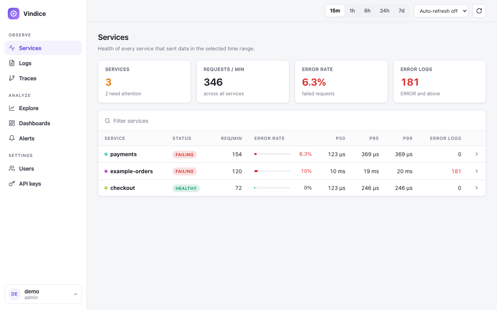
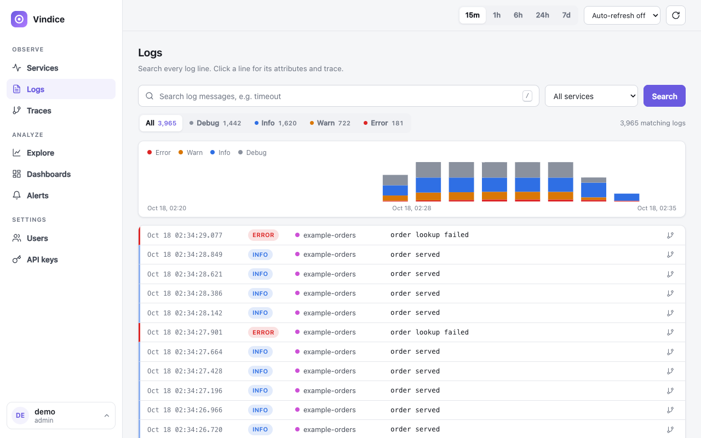
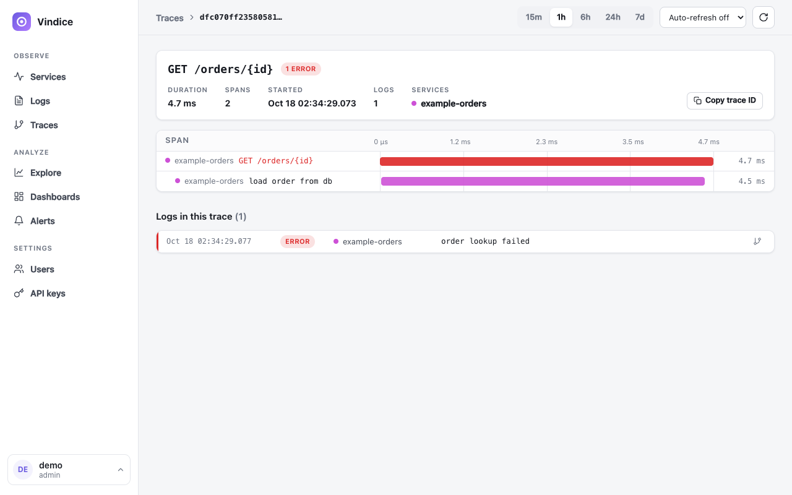
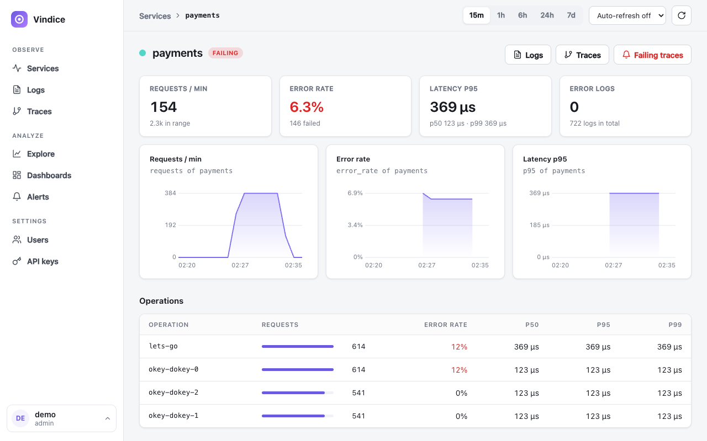
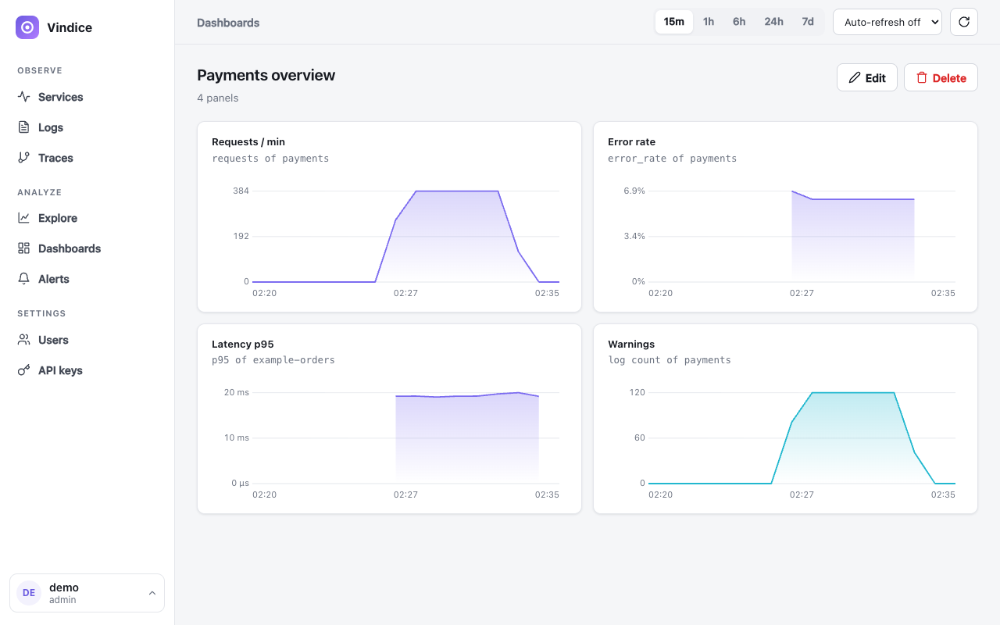
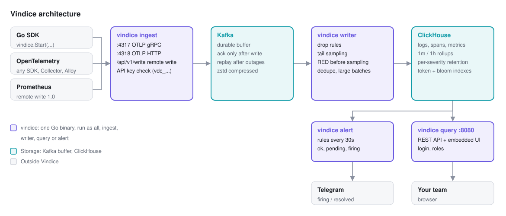
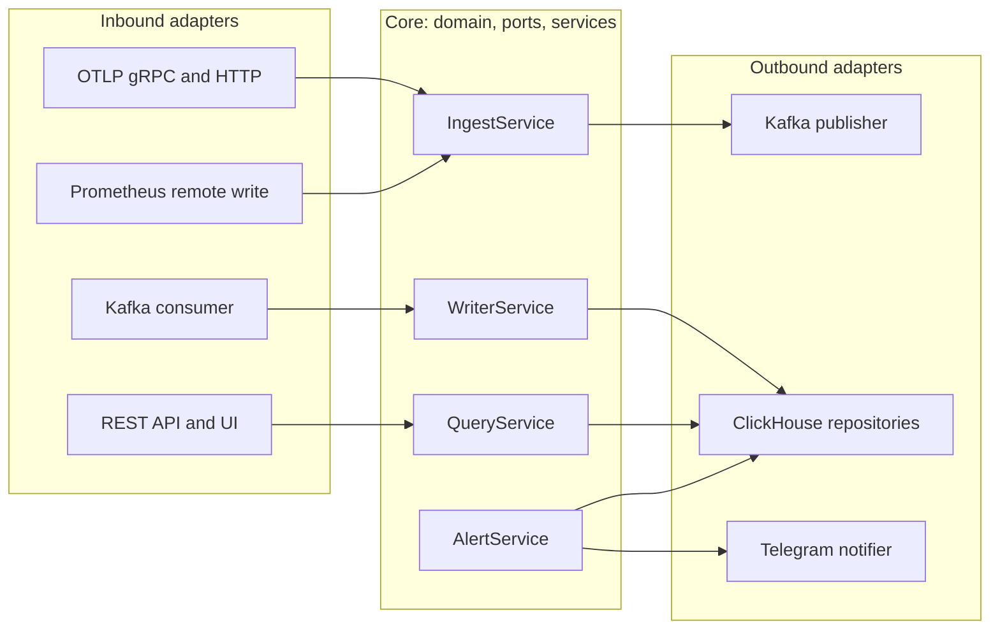

<p align="center">
  
</p>

<h1 align="center">Vindice</h1>

<p align="center">
  <b>Logs, traces and metrics in one place, on one small server.</b><br>
  Self-hosted observability built on OpenTelemetry, Kafka and ClickHouse.
</p>

<p align="center">
  <a href="#quick-start">Quick start</a> ·
  <a href="#a-closer-look">Screenshots</a> ·
  <a href="#how-it-works">How it works</a> ·
  <a href="#why-not-just-lgtm">Compared with LGTM</a> ·
  <a href="sdk/README.md">Go SDK</a> ·
  <a href="docs/reference.md">Docs</a>
</p>

<picture>
  <source media="(prefers-color-scheme: dark)" srcset="docs/assets/screenshots/services-dark.png">
  
</picture>

## Why teams pick Vindice

- **Find the log in seconds.** Search the text of every log line, then narrow it down with one-click level filters that show their counts. There are no label rules to design up front.
- **See the logs inside each trace.** Open a slow or failing request, and the log lines it wrote are on the same page as its spans.
- **Small enough for one server.** It runs as three containers (vindice, Kafka, ClickHouse). Measured at idle with demo data, they used about 1.5 GB of RAM together.
- **Nothing is lost when storage hiccups.** Ingest answers a request only after Kafka has the data, and the writer catches up once ClickHouse is back.
- **Alerts where your team already is.** Rules on error rate, latency, metrics or log counts post to Telegram when they fire and again when they resolve.

## A closer look

| | |
|---|---|
| <picture>   <source media="(prefers-color-scheme: dark)" srcset="docs/assets/screenshots/logs-dark.png">    </picture> | <picture>   <source media="(prefers-color-scheme: dark)" srcset="docs/assets/screenshots/trace-dark.png">    </picture> |
| **Logs.** Search every line, filter by level, and see the volume of each level over time. | **Traces.** The span waterfall, and the logs written inside that request, on one page. |
| <picture>   <source media="(prefers-color-scheme: dark)" srcset="docs/assets/screenshots/service-dark.png">    </picture> | <picture>   <source media="(prefers-color-scheme: dark)" srcset="docs/assets/screenshots/dashboard-dark.png">    </picture> |
| **Services.** Request rate, errors and latency for each service and each operation. | **Dashboards.** Pin service measures, metrics and log counts to dashboards the team shares. |

## Quick start

You need Docker with Compose, and `make`.

```bash
git clone https://github.com/b1ll1eee/vindice-observability && cd vindice-observability
make up                                                # start Kafka, ClickHouse and vindice
docker logs vindice-vindice-1 2>&1 | grep "first admin"  # one-time admin password
open http://localhost:8080                             # sign in, then create a key under API keys
make demo KEY=vdc_...                                  # send sample traces, logs and metrics
```

Refresh the Services page, and the demo services appear with their request rate, errors and latency.

## Send your data

**Any OpenTelemetry SDK or Collector** only needs two environment variables:

```bash
OTEL_EXPORTER_OTLP_ENDPOINT=http://vindice-host:4318   # gRPC: vindice-host:4317
OTEL_EXPORTER_OTLP_HEADERS="Authorization=Bearer vdc_..."
```

**Go services** can use the SDK, which also links each log line to its trace ([sdk/README.md](sdk/README.md)):

```go
// reads VINDICE_ENDPOINT and VINDICE_API_KEY from the environment
sdk, err := vindice.Start(ctx, vindice.Config{ServiceName: "orders"})
defer sdk.Shutdown(context.Background())
http.ListenAndServe(":8080", vindice.Handler(mux, "orders"))
```

**Prometheus** can forward everything it already scrapes:

```yaml
remote_write:
  - url: http://vindice-host:4318/api/v1/write
    authorization:
      credentials: vdc_...
```

## How it works

<picture>
  <source media="(prefers-color-scheme: dark)" srcset="docs/assets/architecture-dark.svg">
  
</picture>

Data flows left to right:
- **Ingest.** Applications send OTLP or Prometheus remote write with an API key. Ingest acknowledges a request only after Kafka has it.
- **Writer.** The writer drops noise and samples traces, keeping every failing or slow trace. It counts request metrics before sampling, so the rates stay exact, and writes large batches to ClickHouse.
- **Query and alert.** Both read from ClickHouse, using pre-aggregated per-minute tables wherever they can.

Storage stays small over time:
- **Log retention by level.** Debug logs expire after 3 days and errors after 90.
- **Metric rollups.** Metrics are rolled up to 1-minute and 1-hour resolution.
- **Compact encoding.** Trace IDs are stored in binary form, and repeated attributes are stored only once.

## Why not just LGTM?

Compared with running the Grafana LGTM stack (Loki, Grafana, Tempo, Mimir) yourself:

| | Vindice | LGTM stack |
|---|---|---|
| **To run** | 3 containers: vindice (one Go binary with the UI built in), Kafka, ClickHouse | Loki, Tempo, Mimir or Prometheus, Grafana, plus an agent |
| **Searching log text** | Indexed full-text search over all logs | Loki indexes labels only; text filters scan the matching chunks |
| **High-cardinality fields** (user id, order id) | Fine to keep as attributes | Must stay out of labels, or the index grows |
| **Logs next to traces** | Built in on the trace page | Configured per data source |
| **Query languages to learn** | None; the UI builds the queries | LogQL, TraceQL, PromQL |
| **Trace sampling** | Built-in tail sampling; request rates are counted before sampling | Set up separately in the collector |
| **When storage is down** | Kafka holds incoming data until the writer catches up | Depends on each component's write-ahead log |

**Where LGTM is still ahead:**
- PromQL, and its large catalogue of ready-made dashboards and exporters.
- Mature alert routing, such as silences and on-call schedules.
- Long retention on object storage from the start.
- A much larger community.

You don't have to choose up front. Send the same data to both from an OpenTelemetry Collector or Grafana Alloy, and compare them on your own traffic.

## What's included

| Feature | What it does |
|---|---|
| **Services** | Request rate, error rate and p50/p95/p99 latency per service and per operation, with Healthy, Degraded and Failing badges |
| **Logs** | Full-text search, filters for service and level, a histogram by level, and one click to the trace |
| **Traces** | Waterfall with span details, events and attributes, plus the trace's own logs |
| **Explore and dashboards** | Chart any metric (`rate`, `avg`, `max`, ...) or a service measure, group it by an attribute, and pin it to a dashboard |
| **Alerts** | Thresholds held for a set time, sent to Telegram on firing and on resolve, with a history of events |
| **Team access** | Sign-in with viewer, editor and admin roles, and API keys for the services that send data |
| **Inputs** | OTLP over gRPC and HTTP, Prometheus remote write, and a Go SDK |

<details>
<summary><b>Inside the code</b>: hexagonal design</summary>
<br>



- **The core holds the rules.** It owns sampling, retention, alert state and permissions, and talks to the outside only through interfaces.
- **Adapters do the plumbing.** They translate between those interfaces and OTLP, Kafka, ClickHouse, HTTP and Telegram, so each piece can be tested on its own or swapped.
- **Reads and writes are separate.** Charts read pre-aggregated rollups without touching the write path.
- **Everything is wired in one place,** `cmd/vindice/main.go`. The same binary runs as one process, or splits into `ingest`, `writer`, `query` and `alert` processes when traffic grows.

</details>

<details>
<summary><b>Everyday commands</b></summary>
<br>

```bash
make up            # build and start the stack
make down          # stop it
make logs          # follow the vindice log
make demo KEY=...  # send sample telemetry
make stats         # rows and disk size per ClickHouse table
make test          # unit tests for the server and the SDK
make lint          # go vet and gofmt
make web-dev       # UI with hot reload on :5173 (API on :8080)
```

</details>

## Documentation

- [docs/reference.md](docs/reference.md): every setting, the REST API, security details, storage design and known limits.
- [sdk/README.md](sdk/README.md): the Go SDK.

## Status

Everything above works today with Docker Compose. Known limits are listed in the [reference](docs/reference.md#known-limits). The main ones:
- **Single instances.** Tail sampling needs a single writer, and alerting needs a single evaluator.
- **Not stored yet.** Exponential histograms are skipped.

## License

[MIT](LICENSE)
